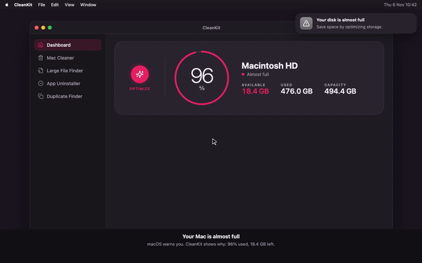

# Flowcast

Turn a feature or a story into something people watch.

Point it at a feature in your app, or paste the story of a workflow, and Flowcast designs the scene, writes the beats, and plays it back as a small animated intro. Then export it as an MP4, a GIF, PNG frames or a PDF carousel, sized for where you post it.


*Flowcast explaining itself, made with Flowcast. [Watch the MP4](docs/samples/flowcast-launch.mp4).*



*Made with Flowcast from the CleanKit app's own code: the Mac's storage fills up, CleanKit scans, finds Slack, Chrome and Xcode caches, and frees 29.1 GB. [Watch the MP4](docs/samples/cleankit-storage.mp4).*

The rule behind every intro: **show, don't tell.** The product acts itself out with its own screens, colours and logo, so a stranger understands how it works in a few seconds.

## What you can make

| From | You get |
|---|---|
| A feature in your project (Flutter, Compose, SwiftUI, web, anything) | An intro in the app's real look: its colours, fonts, components and logo |
| A story with no app, such as an n8n workflow | A scene of the people and systems involved: the customer's phone, your Stripe list, your Slack |
| Either | MP4 video, GIF, PNG frames, PDF slides, a web embed, or the intro rewritten in your app's own code |

## Install

### Claude Code, as a plugin

```
/plugin marketplace add azharbinanwar/flowcast
/plugin install flowcast@flowcast
```

### Claude Code or any Agent Skills agent, as a skill

```bash
npx skills add azharbinanwar/flowcast
```

### claude.ai

Upload the `skills/flowcast` folder as a skill. You get the beats, the playable preview and the post text. Video export needs Claude Code.

## Video toolchain, once

MP4, GIF, frames and slides are made with headless Chromium and ffmpeg. Both come from npm, nothing else to install. In the skill folder:

```bash
npm install
```

Claude runs this for you the first time you export.

## Use

```
/flowcast prayer alarm                    a feature in the project you are in
/flowcast <paste a story or a post>       no project needed
/flowcast                                 History: every intro you made here
```

Flowcast answers with the beats and opens the studio in your browser. `/flowcast-history`, or "open flowcast", reopens History any time, and starts the studio if it isn't running.

### Where things are saved

```
flowcast/
  <feature>/
    intro.html          the source: beats, scene, words
    intro.state.json    what you set on the page
    exports/            your MP4, GIF, PDF and frames
```

Keep the folder and you can export any intro again, in any format, later.

### The studio

A local page with the intro playing on the left and every option in a drawer on the right. Each section opens and closes on its own and has a reset in its header when something in it has changed.

- **Look:** dark mode and captions, as switches.
- **Privacy:** Hide personal details swaps emails, phone numbers and card numbers for safe samples.
- **Credit:** off until you turn it on. Made with Flowcast, with the Flowcast repo link if you want it. Show it as an outro slide after your end card, in your intro's own colours, with its own seconds in Timing, or as a small watermark for the whole video in any corner.
- **Colours:** every colour in the intro, its light and dark shade side by side, grouped by product or part. Reset one colour, one group, or all.
- **Canvas:** no canvas, 1080×1080 for LinkedIn and Instagram feed, 1080×1350 for Instagram portrait, 1080×1920 for Reels, Stories, TikTok and Shorts, 1920×1080 for YouTube and websites. Device or scene left, centre or right, and the slots around it: headline, line, CTA, tags and logo. Click any of them on the page to change the words.
- **Timing:** a speed for the whole intro, and each beat's own seconds. A shorter beat plays its animation faster to fit, a longer one slower, from a third of its time to double.
- **Export:** pick MP4, GIF, PNG frames or PDF slides, then Export. The label shows the running time, or how many images or pages you get. The file lands in the intro's `exports/` folder and its name becomes a button that opens the folder.

Under the video: replay, previous, play or pause, next, and full screen, which plays the video alone the way a viewer sees it. Esc brings the studio back.

What you set on the page is what gets exported, pixel for pixel. Your choices are saved, so a refresh or an export asked for in words uses them too.

### Ask in words

```
export as mp4
gif for linkedin
reel, dark, no captions
slides pdf
change beat 2 to say ...
```

## Files

| Export | Name |
|---|---|
| Video | `exports/flowcast-<project>-<date>-<time>.mp4` |
| GIF | `exports/flowcast-<project>-<date>-<time>.gif` |
| Slides | `exports/flowcast-<project>-<date>-<time>.pdf` |
| Frames | `exports/flowcast-<project>-<date>-<time>/flowcast-1.png`, `flowcast-2.png`, … with the end card last |

## Requirements

- Node 18 or newer for exports.
- About 250 MB for Chromium and ffmpeg after `npm install`.
- macOS, Windows or Linux.

## Layout

```
.claude-plugin/          plugin manifest and marketplace entry
skills/flowcast-history/SKILL.md   reopens History
skills/flowcast/
  SKILL.md               how Claude designs an intro from a feature or a story
  stage.md               the intro file contract on the shared player
  record.md              recording and converting
  player/                the shared player: frames, canvas sizes, modes, toolbar
  examples/              a sample intro, used by the tests
docs/samples/            example exports
  scripts/               studio, recorder, converter, frames and slides, contact sheet
```

## Roadmap

Just added, not yet released:

- **Hide personal details.** One switch in the studio's Privacy section turns emails, phone numbers and card numbers into safe samples in the preview and every export. Names can't be told apart from other words, so keep real names out of the story.
- **Manage intros in History.** Rename, duplicate or delete an intro from the ⋯ menu on its card. Delete moves it to the Trash, so it can be put back.

Planned:

- **Export everything in one click.** MP4, GIF, PDF and PNG, in square, reel and wide, all at once into the exports folder.
- **A post to go with it.** The LinkedIn, X and Instagram caption written from the beats, with a copy button.
- **Background music.** A short track mixed into the MP4 at the right length, or none.
- **Brand kit per project.** The project's logo, colours and font saved once and used by every new intro in it.
- **More languages.** The same video with its headlines and captions in other languages, exported side by side.

## Contributing

See [CONTRIBUTING.md](CONTRIBUTING.md). Run the tests from `skills/flowcast` with `npm test`.

## License

MIT. See [LICENSE](LICENSE).

## Version

1.0.0. See [CHANGELOG.md](CHANGELOG.md).
